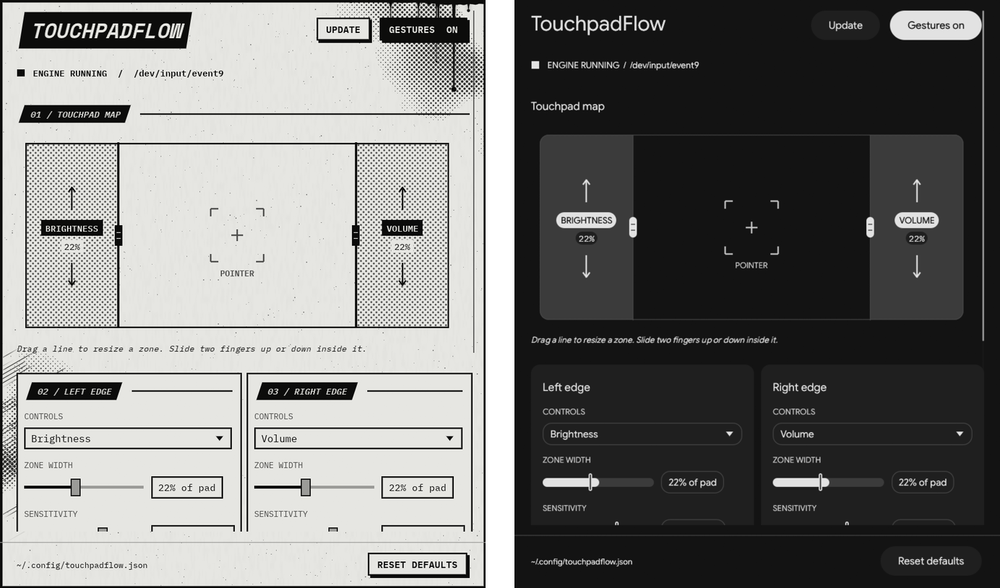
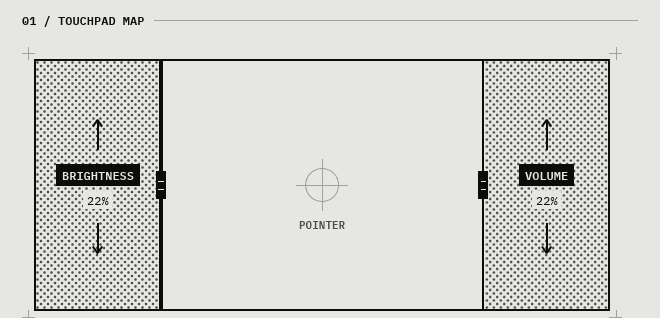
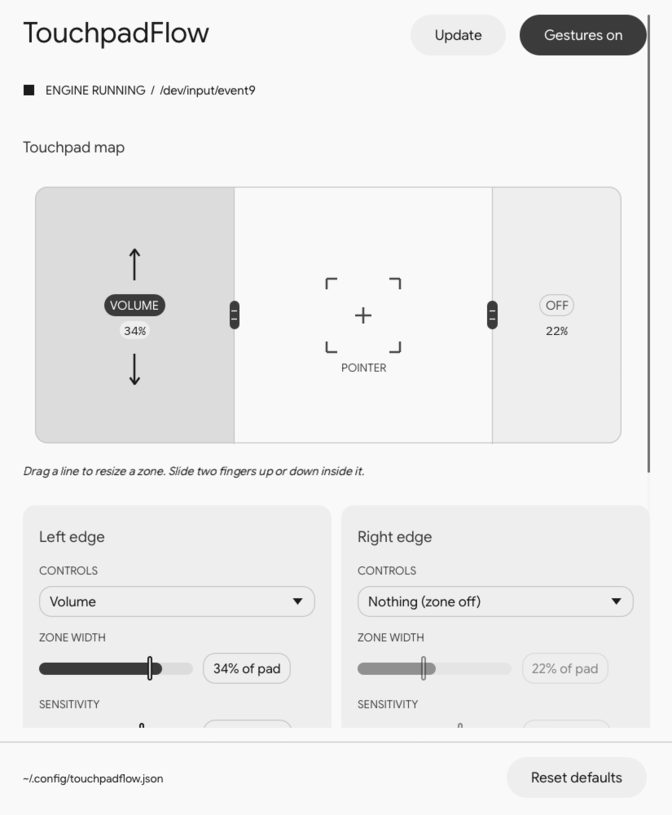
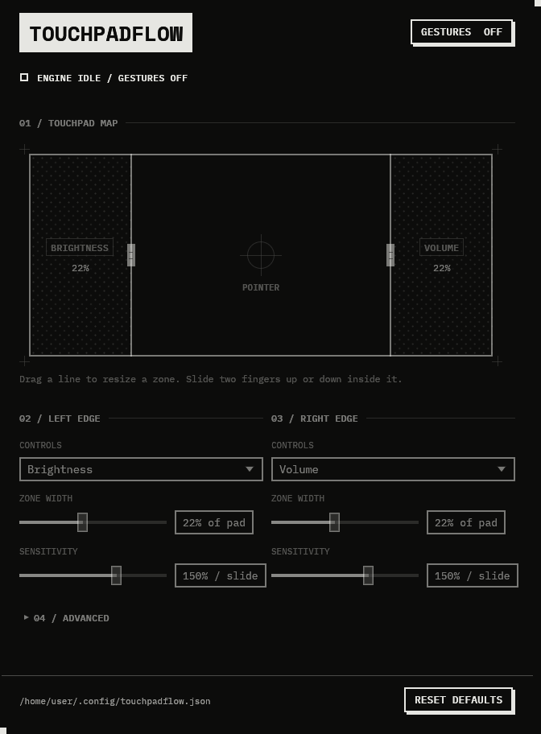

<p align="center">
  
</p>

<h1 align="center">TouchpadFlow</h1>

<p align="center">
  <b>Slide two fingers along the edge of your touchpad to change brightness and volume.</b><br>
  For Linux, macOS and Windows.
</p>

<p align="center">
  <a href="https://github.com/l41n-pr0t0/TouchpadFlow/releases/latest"></a>
  <a href="https://github.com/l41n-pr0t0/TouchpadFlow/actions/workflows/ci.yml"></a>
  
  <a href="LICENSE"></a>
</p>

---

## Install

**Linux** (any distro) **and macOS**: paste into a terminal:

```bash
curl -fsSL https://raw.githubusercontent.com/l41n-pr0t0/TouchpadFlow/main/install.sh | bash
```

**Windows 10 / 11**: paste into PowerShell (no admin rights needed):

```powershell
irm https://raw.githubusercontent.com/l41n-pr0t0/TouchpadFlow/main/install.ps1 | iex
```

That's it. The installer picks the right download for your computer, adds **TouchpadFlow** to your app menu, and starts it automatically every time you log in.

> [!NOTE]
> **Linux** asks for your password once, to let your account use the touchpad without root.
> **macOS** needs one permission for brightness: *System Settings → Privacy & Security → Accessibility → allow `touchpadflow-macos`*.

Prefer a normal installer? Grab it from the [**releases page**](https://github.com/l41n-pr0t0/TouchpadFlow/releases/latest):

- **Windows:** `TouchpadFlow-Setup-x64.exe` (or `-arm64.exe`). No admin rights needed.
- **macOS:** `TouchpadFlow-macos-universal.dmg`. Drag **TouchpadFlow** to Applications and open it once; it starts the engine at every login from then on.
  The build is not notarized, so the first time right-click the app → **Open** (or run `xattr -dr com.apple.quarantine /Applications/TouchpadFlow.app`).

Already installed? The **UPDATE** button in the app installs the latest release for you.

---

## Use it

Put **two fingers** on the left or right edge of the touchpad and slide **up** or **down**.

| Where | Default | Slide up | Slide down |
| :--- | :--- | :--- | :--- |
| Left edge | Brightness | Brighter | Dimmer |
| Right edge | Volume | Louder | Quieter |
| Middle | Your normal touchpad | Scroll, click and move as usual | |

Everything outside the edge zones behaves exactly like before.

---

## Settings

Open **TouchpadFlow** from your app menu. Changes apply the moment you make them; there is no save button.

<p align="center">
  
</p>

| Setting | What it does |
| :--- | :--- |
| **Gestures on / off** | Turns TouchpadFlow off and gives the touchpad straight back to your system. |
| **Touchpad map** | Drag a line to make a zone wider or narrower (5–45% of the pad). |
| **Controls** | Choose what each edge changes: *Brightness*, *Volume*, or *Nothing*. |
| **Sensitivity** | How much one full top-to-bottom slide changes the value. |
| **Advanced** | A small dead zone so resting fingers don't nudge values, and how long an edge touch waits for a second finger. |

<table>
  <tr>
    <td width="50%"></td>
    <td width="50%"></td>
  </tr>
  <tr>
    <td align="center"><sub>Left edge set to volume, right edge turned off</sub></td>
    <td align="center"><sub>Gestures off, in dark mode</sub></td>
  </tr>
</table>

The app follows your system's light or dark theme.

---

## Extra gestures on Linux

| Gesture | Action |
| :--- | :--- |
| Three-finger tap | Middle click |
| Three-finger swipe left / right | Previous / next track |
| Four-finger swipe up / down | Overview / show desktop *(KDE Plasma)* |
| Four-finger swipe left / right | Previous / next virtual desktop *(KDE Plasma)* |

---

## Works with

| | Linux | macOS | Windows |
| :--- | :--- | :--- | :--- |
| **Desktops** | KDE Plasma, GNOME, Hyprland, Sway, Xfce and others (Wayland and X11) | macOS on Apple Silicon and Intel | Windows 10 and 11 |
| **Touchpads** | Any multitouch touchpad | Built-in trackpads | Precision Touchpads |
| **Volume** | PipeWire, PulseAudio or ALSA | System volume | System volume |
| **Brightness** | Built-in laptop screens | Built-in screens | Built-in screens |

---

## Troubleshooting

<details>
<summary><b>My touchpad feels stuck or wrong. How do I turn TouchpadFlow off quickly?</b></summary>

Click **Gestures on** in the app to switch it off. On Linux you can also run:

```bash
touchpadflow --toggle
```

Your touchpad goes back to normal immediately. Run it again to turn TouchpadFlow back on.
</details>

<details>
<summary><b>The app says “Engine not running” (Linux)</b></summary>

```bash
systemctl --user restart touchpadflow          # start it again
journalctl --user -u touchpadflow -n 50        # see why it stopped
```

If the log says the touchpad can't be opened, log out and back in once after installing, so the new permission applies.
</details>

<details>
<summary><b>Brightness doesn't change (Linux)</b></summary>

Some laptops need the `brightnessctl` package. Install it from your distro (for example `sudo dnf install brightnessctl` or `sudo apt install brightnessctl`).
</details>

<details>
<summary><b>The installer says the download doesn't run on my Linux</b></summary>

Ready-made Linux builds need a distro from 2022 or newer (Ubuntu 22.04, Debian 12, Fedora 36 or later). On older systems, build it yourself; see [Build from source](#build-from-source).
</details>

<details>
<summary><b>Windows SmartScreen warns about the app</b></summary>

The app isn't code-signed yet. Choose *More info → Run anyway*. If something goes wrong, the log is at `%LOCALAPPDATA%\TouchpadFlow\TouchpadFlow.log`.
</details>

---

## Privacy

- **Nothing leaves your computer.** TouchpadFlow has no network code; on Linux the service is also blocked from the network by systemd.
- **Touchpad only.** It never reads your keyboard and never records where you touch.
- **No admin rights.** It runs as your user on every platform.

Details are in [SECURITY.md](SECURITY.md).

---

## Uninstall

**Linux and macOS**

```bash
curl -fsSL https://raw.githubusercontent.com/l41n-pr0t0/TouchpadFlow/main/install.sh | bash -s -- --uninstall
```

**Windows** (PowerShell)

```powershell
& ([scriptblock]::Create((irm https://raw.githubusercontent.com/l41n-pr0t0/TouchpadFlow/main/install.ps1))) -Uninstall
```

Your settings are kept, in case you reinstall.

---

## Build from source

Needs [Rust](https://rustup.rs) 1.95 or newer.

```bash
git clone https://github.com/l41n-pr0t0/TouchpadFlow
cd TouchpadFlow
./install.sh --from-source
```

On Windows, see [windows/README.md](windows/README.md). Contributions are welcome; start with [CONTRIBUTING.md](CONTRIBUTING.md).

---

<p align="center">
  <sub>Apache-2.0 · Bundles <a href="assets/fonts">IBM Plex Mono and Space Mono</a> under the SIL Open Font License</sub>
</p>
